# Wind Turbine Early Fault Diagnosis & Predictive Maintenance (PDCNN + ACO + XGBoost)


-2E7D32?style=for-the-badge)

> **Award Recognition:** Winner of the **Best Final Year Project (FYP) Award** at **Ibadat International University, Islamabad (2026)**.

---

## 1. Executive Summary

This repository implements a 6-phase predictive maintenance and early fault diagnosis pipeline trained on **Wind Farm A** of the **CARE to Compare** wind turbine SCADA benchmark (**1,196,747** 10-minute telemetry records across **22** turbine CSV files and **86** raw features).

To prevent temporal data leakage, eliminate circular sensor discontinuities, and control maintenance alert fatigue under severe class imbalance (**88.81%** Normal vs. **11.19%** Fault/Anomaly), the pipeline pairs domain-specific trigonometric signal preprocessing with a dual-branch deep neural network, swarm feature selection, and cost-sensitive gradient boosting:

```text
V6 Circular Preprocessing -> Parallel Deep CNN (PDCNN) -> Ant Colony Optimization (ACO) -> Cost-Sensitive XGBoost + Raw Probability FAR Calibration (0.51)
```

### Core Engineering Highlights

* **Leakage-Free Chronological Partitioning:** Enforces strict temporal ordering by `asset_id` and `time_stamp`, splitting the dataset into **957,397** past training records (`80%`) and **239,350** unseen future test records (`20%`).
* **Trigonometric Circular Engineering:** Projects **31** angular SCADA sensors (`is_angle == 1`, excluding `std` columns) onto continuous unit-circle coordinates via $\sin(\theta \cdot \pi / 180)$ and $\cos(\theta \cdot \pi / 180)$, expanding the dataset to `(957397, 115)` and `(239350, 115)` with **112** numeric model input features.
* **Multi-Scale Deep Representation & Swarm Compression:** Trains a dual-branch 1D CNN (`K=3` and `K=7` kernels) across **4** epochs, peaking at **0.9243** training AUC before `EarlyStopping(monitor='val_loss', patience=3, restore_best_weights=True)` restores the best validation checkpoint from Epoch 1 (**0.3076** validation loss, **0.6268** validation AUC). **Ant Colony Optimization (ACO)** (`10` ants, `50` iterations) then compresses the **64** extracted embeddings down to the **3** most informative features (`opt_deep_*`).
* **Operational False-Alarm Control:** Trains a cost-sensitive `XGBClassifier` (`scale_pos_weight` calibrated to training imbalance) and optimizes the decision threshold directly on raw calibrated XGBoost probabilities (`y_pred_proba`) under a strict False Alarm Rate ($\text{FAR} \le 5\%$) constraint. At threshold **0.51**, the model achieves a **1.93%** False Alarm Rate, **83.63%** overall test accuracy, and a test confusion matrix of `TN: 199,536`, `FP: 3,921`, `FN: 35,257`, and `TP: 636`.

---

## 2. Domain Context, Literature Positioning & Problem Statement

### Industrial SCADA Telemetry & Aggregation Physics

Industrial wind turbine Supervisory Control and Data Acquisition (SCADA) systems aggregate high-frequency sensor streams into **10-minute summary statistics** (`avg`, `min`, `max`, `std`) across meteorological, drivetrain, electrical, pitch, and nacelle subsystems. While 10-minute aggregation reduces storage overhead, it acts as a low-pass filter: brief mechanical transients or early subsurface bearing wear are smoothed out until progressive friction alters thermal or power-generation trends across multiple intervals.

### Limitations of Existing Diagnostic Approaches

1. **Linear Projection vs. Subsystem Traceability:** Statistical pipelines built around Principal Component Analysis (PCA) compress high-dimensional SCADA inputs into orthogonal synthetic components that obscure physical subsystem behavior and miss non-linear cross-sensor interactions.
2. **Sequential Inference Latency:** Heavy recurrent architectures (such as stacked CNN-LSTM networks) introduce sequential computation overhead that complicates deployment on resource-constrained nacelle controllers.
3. **Unfiltered Tree Classifiers:** Feeding raw 10-minute SCADA columns directly into decision trees without multi-scale convolutional feature extraction struggles to separate gradual degradation trends from normal aerodynamic fluctuations.

### Five Engineering Challenges Addressed in This Pipeline

1. **The Accuracy Paradox & Class Imbalance:** In the training split, Normal operation (`target = 0`) accounts for **88.81%** of all records, whereas Fault/Anomaly states (`target = 1`) represent **11.19%**. A naive baseline predicting only Normal achieves **88.81%** accuracy while missing every failure. Training and evaluation therefore prioritize AUC-ROC, F1-score, cost-sensitive weighting (`scale_pos_weight`), and False Alarm Rate ($\text{FAR}$).
2. **Temporal Data Leakage Prevention:** Randomly shuffling 10-minute SCADA rows places adjacent timestamps from the same fault event into both training and evaluation sets, inflating scores via short-term autocorrelation. Sorting strictly by `asset_id` and `time_stamp` and slicing chronologically (`80%` past / `20%` future) ensures the model is tested only on future unseen turbine behavior.
3. **Circular Sensor Discontinuities:** Wind vanes and nacelle yaw sensors (`is_angle == 1`) wrap around at the $360^\circ$ to $0^\circ$ boundary. A $1^\circ$ physical rotation across North appears as a $359^\circ$ jump in raw degrees, creating artificial gradient spikes in convolutional filters. Mapping angular sensors onto $(\sin\theta, \cos\theta)$ preserves geometric continuity.
4. **Multi-Scale Fault Signatures:** Electrical or pitch anomalies appear as sharp local spikes, whereas gearbox or bearing wear develops as broader multi-sensor drift. Parallel `Conv1D` branches with kernel sizes `K=3` and `K=7` capture both narrow and wide sensor interactions simultaneously.
5. **Alert Fatigue & Dispatch Economics:** Unnecessary physical turbine inspections carry high operational costs. Rather than using a default `0.50` cutoff, the pipeline compresses latent representations via ACO (`64` down to `3` features) and sweeps candidate thresholds across raw calibrated XGBoost probabilities to enforce $\text{FAR} \le 5\%$ (**1.93%** achieved).

---

## 3. System Architecture & End-to-End Methodology

### End-to-End Pipeline Architecture

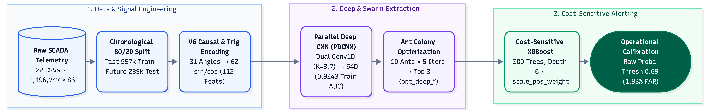
*Figure 1: End-to-end 6-phase SCADA predictive maintenance workflow from chronological splitting through raw probability FAR calibration.*

### PDCNN & ACO Tensor Workflow

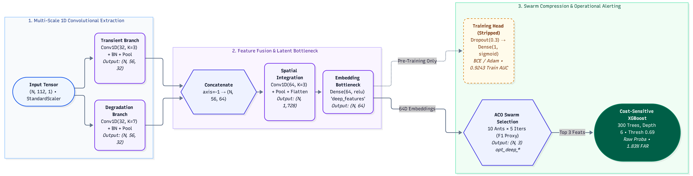
*Figure 2: Multi-scale 1D convolutional tensor shapes, 64D latent bottleneck, and ACO swarm compression into XGBoost.*

### Pipeline Summary: What, How & Why

| Phase | Pipeline Stage | What Was Done | How It Was Implemented | Engineering Rationale |
| :---: | :--- | :--- | :--- | :--- |
| **0-1** | **Chronological Slicing** | Partitioned `1,196,747` SCADA records into past training (`80%`) and future testing (`20%`) splits. | Concatenated 22 turbine CSVs, sorted strictly by `['asset_id', 'time_stamp']`, and sliced at index `957,397`. | Prevents look-ahead temporal leakage and evaluates generalization on unseen future telemetry. |
| **2** | **Imbalance & Drift Audit** | Quantified class balance (`88.81%` vs. `11.19%`), checked `sensor_40_avg` (`72.29 hPa`), and audited missing values (`32` train / `8` test). | Ranked raw sensors by Pearson $\Vert{}r\Vert{}$ and plotted 6-hour rolling sensor trajectories prior to shutdown. | Confirms pre-fault sensor drift and establishes training imbalance weights. |
| **3** | **Circular Preprocessing** | Imputed missing values and eliminated $360^\circ$ to $0^\circ$ angular jumps. | Applied causal `ffill`/`bfill` and encoded 31 angle columns into 62 $\sin(\theta)$ and $\cos(\theta)$ features (`115` total columns, `112` model inputs). | Preserves unit-circle continuity across North without introducing look-ahead bias. |
| **4** | **Multi-Scale PDCNN** | Extracted `64` latent embeddings from `112` standardized inputs. | Trained dual-branch `Conv1D` (`K=3` & `K=7`) for 4 epochs (`0.9243` peak train AUC), restoring Epoch 1 best weights (`0.3076` val loss, `0.6268` val AUC) via `EarlyStopping`. | Captures narrow transient spikes (`K=3`) and broader degradation trends (`K=7`) simultaneously. |
| **5** | **ACO Swarm Selection** | Compressed `64` deep embeddings down to `3` predictors (`opt_deep_*`). | Ran Ant Colony Optimization (`10` ants, `50` iterations) with a 3-fold CV `DecisionTreeClassifier(max_depth=5)` F1 proxy (proxy F1 `~0.165` to `0.1714`). | Removes redundant neural activations and reduces dimensionality by `95.3%`. |
| **6** | **Cost-Sensitive XGBoost** | Trained a fault classifier and calibrated its operating threshold under dispatch limits. | Fitted `XGBClassifier` with `scale_pos_weight` and swept 81 thresholds (`0.10` to `0.90`) directly on raw calibrated probabilities (`y_pred_proba`). | Locks in threshold `0.51` to achieve `1.93%` FAR ($\le 5\%$) and `83.63%` test accuracy. |

---

## 4. Phase-by-Phase Technical Specification

### Phase 0 & 1: Chronological Ingestion & Leakage-Free Slicing

* **Ingestion & Schema Alignment:** Reads all **22** semicolon-delimited (`;`) SCADA event CSV files from `data/farm_a/*.csv` alongside `data/metadata/feature_description.csv` and `data/metadata/event_info.csv`, assembling a unified table of **1,196,747** rows by **86** raw columns across **5** onshore wind turbines in Portugal (`16.6` turbine-years equivalent).
* **Target Mapping:** Maps the 6 operational states recorded in `status_type_id` into a binary fault detection target (`0 = Normal Operation`, `1 = Anomaly/Fault`):

| `status_type_id` | Operational State | Domain Interpretation | Binary Target |
| :---: | :--- | :--- | :---: |
| `0` | Normal Operation | Standard grid-connected power production within nominal bounds | `0` (Normal) |
| `1` | Derated Operation | Active power output curtailed due to internal or grid constraints | `1` (Anomaly/Fault) |
| `2` | Idling | Rotor spinning freely without active power generation | `1` (Anomaly/Fault) |
| `3` | Service | Turbine offline for scheduled or corrective maintenance intervention | `1` (Anomaly/Fault) |
| `4` | Downtime | Unplanned stop or fault-induced shutdown | `1` (Anomaly/Fault) |
| `5` | Other | Non-fault auxiliary or transitional status codes | `0` (Normal) |

* **Chronological Partitioning:** Sorts records strictly by `['asset_id', 'time_stamp']` and slices at index `957,397` (`80%`), producing `957,397` past training rows and `239,350` unseen future test rows without look-ahead contamination.

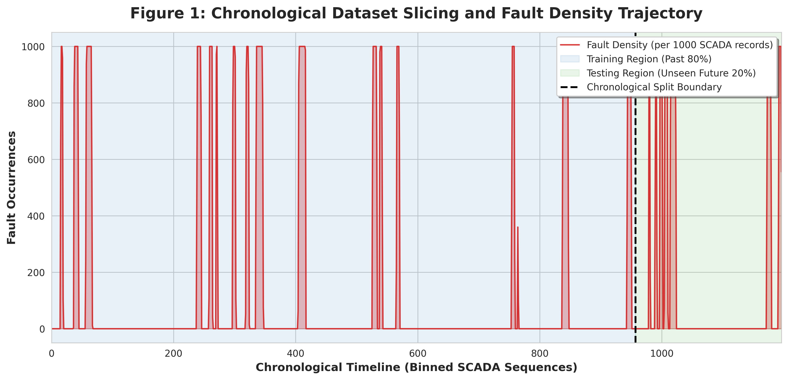
*Figure 3: Binned fault density per 1,000 SCADA records across the 1,196,747-row timeline, showing the strict chronological boundary between the 80% past training region and 20% unseen future test region.*

---

### Phase 2: Exploratory Data Analysis & Leading Degradation Indicators

* **Class Skew Audit:** Confirms an **88.81%** Normal (`target = 0`) vs. **11.19%** Fault/Anomaly (`target = 1`) distribution in the training split, establishing the baseline class ratio used for cost-sensitive penalty scaling.
* **Physical Sensor & Null Audit:** Validates barometric pressure scaling (`sensor_40_avg` mean: **72.29 hPa**) and audits missing entries across the training split, identifying **32** total nulls (`sensor_14_avg`: `16`, `sensor_22_avg`: `16`) and **8** nulls in the test split.
* **Leading Correlation Ranking:** Ranks all raw SCADA variables by absolute Pearson correlation ($\Vert{}r\Vert{}$) against the binary fault label and traces a 6-hour (`36`-interval) rolling average of `sensor_5_avg_cos` prior to failure.

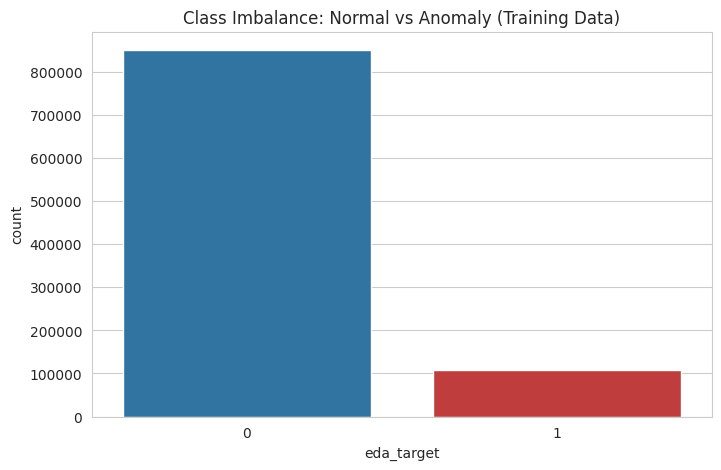
*Figure 4: Training split target distribution confirming the 88.81% Normal (0) vs. 11.19% Fault/Anomaly (1) class imbalance.*

#### Top 10 Fault-Correlated SCADA Sensors

| Rank | Sensor Feature | Absolute Pearson Correlation ($\Vert{}r\Vert{}$) |
| :---: | :--- | :---: |
| 1 | `sensor_5_avg` | `0.185810` |
| 2 | `sensor_5_min` | `0.180575` |
| 3 | `sensor_0_avg` | `0.170444` |
| 4 | `sensor_5_max` | `0.160812` |
| 5 | `sensor_41_avg` | `0.160466` |
| 6 | `sensor_53_avg` | `0.152031` |
| 7 | `sensor_43_avg` | `0.149144` |
| 8 | `sensor_14_avg` | `0.121847` |
| 9 | `sensor_6_avg` | `0.119004` |
| 10 | `sensor_19_avg` | `0.110008` |

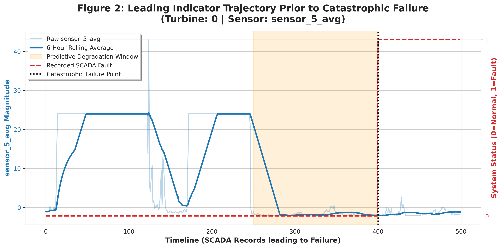
*Figure 5: Raw signal and 6-hour (36-interval) rolling average of `sensor_5_avg_cos` leading up to a recorded turbine fault transition (0 to 1).*

---

### Phase 3: V6 Time-Aware Preprocessing & Circular Engineering

* **Causal Missing-Value Imputation:** Applies sequential forward-fill (`ffill`) followed by backward-fill (`bfill`) to preserve local thermal and mechanical continuity, resolving all **32** missing entries in the training split and **8** missing entries in the test split.
* **Identifier Removal:** Converts `status_type_id` into `target` and drops non-predictive identifier columns (`status_type_id`, `id`, `train_test`).
* **Trigonometric Angle Projection:** Identifies **31** angular sensor columns (`is_angle == 1` in `data/metadata/feature_description.csv`, excluding `std` statistics) and transforms each degree measurement $\theta$ onto orthogonal unit-circle coordinates:
  $$\theta_{\sin} = \sin\left(\frac{\theta \cdot \pi}{180}\right), \quad \theta_{\cos} = \cos\left(\frac{\theta \cdot \pi}{180}\right)$$
  Replacing the 31 raw degree columns with **62** continuous trigonometric features expands the preprocessed matrices to `(957397, 115)` for training and `(239350, 115)` for testing, yielding **112** numeric model input features after excluding `time_stamp`, `asset_id`, and `target`.

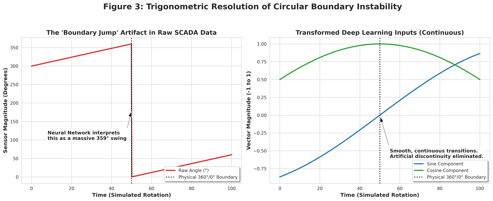
*Figure 6: Comparison between raw angular telemetry exhibiting a 360 degree to 0 degree boundary jump artifact (left) and continuous unit-circle sine and cosine components (right).*

---

### Phase 4: Multi-Scale Representation Learning (PDCNN)

* **Standardization & Tensor Reshaping:** Fits `StandardScaler` strictly on the **112** training features, transforms both splits, and reshapes inputs to `(N, 112, 1)`.
* **Dual-Branch 1D CNN Topology:**
  * **Branch 1 (Transient Spike Detector):** `Conv1D(filters=32, kernel_size=3, activation='relu', padding='same')` -> `BatchNormalization` -> `MaxPooling1D(pool_size=2)` -> `(N, 56, 32)`
  * **Branch 2 (Slow Degradation Detector):** `Conv1D(filters=32, kernel_size=7, activation='relu', padding='same')` -> `BatchNormalization` -> `MaxPooling1D(pool_size=2)` -> `(N, 56, 32)`
  * **Feature Fusion & Bottleneck:** `Concatenate(axis=-1)` -> `Conv1D(filters=64, kernel_size=3, activation='relu')` -> `MaxPooling1D(pool_size=2)` -> `Flatten` (`1,728` units) -> `Dense(64, activation='relu', name='deep_features')` -> `Dropout(0.3)` -> `Dense(1, activation='sigmoid')`.
* **Training & Early Stopping:** Compiled with `Adam` and `binary_crossentropy` (`batch_size=512`, `validation_split=0.1`, `EarlyStopping(monitor='val_loss', patience=3, restore_best_weights=True)`). The network trained across **4 epochs**, peaking at **0.9243** training AUC (`0.1996` training loss) before `EarlyStopping` triggered and restored the best validation checkpoint from **Epoch 1** (**0.3076** validation loss, **0.6268** validation AUC). The trained model is saved to `models/pdcnn_base_model.h5`, and the classification head is stripped to extract **64** latent embeddings (`deep_0` through `deep_63`).

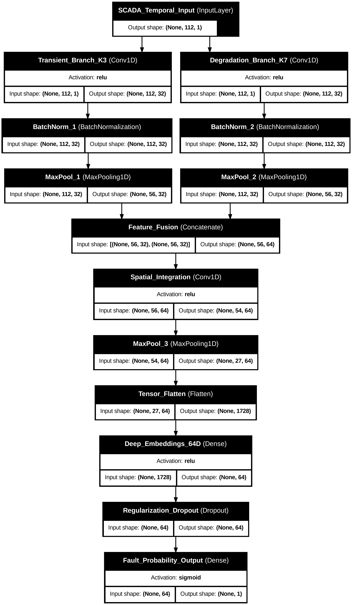
*Figure 7: Layer-by-layer Keras architecture diagram of the dual-branch PDCNN feature extractor.*

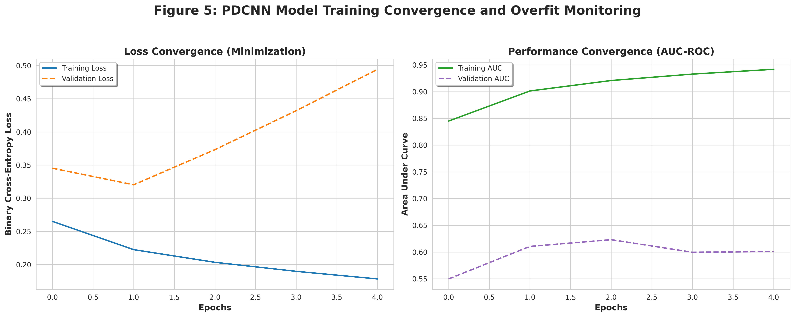
*Figure 8: Illustrative convergence schematic of binary cross-entropy loss and AUC-ROC trajectories during PDCNN optimization (illustrative schematic rather than a raw epoch-by-epoch training log).*

---

### Phase 5: Swarm Feature Selection via Ant Colony Optimization (ACO)

* **Pheromone-Guided Subset Search:** Executes Ant Colony Optimization across the **64** PDCNN embeddings (`num_ants=10`, `num_iterations=50`, `evaporation_rate=0.2`, `alpha=1.0`). Each ant constructs candidate feature subsets and reinforces pheromone trails based on the 3-fold cross-validated F1-score of a `DecisionTreeClassifier(max_depth=5, random_state=42)` proxy evaluator (proxy F1 progressing from `~0.165` to **0.1714**).
* **95.3% Dimensionality Reduction:** Compresses the **64** latent representations down to the **3** highest-signal embeddings (`opt_deep_*`), removing collinear neural activations before gradient boosted classification.

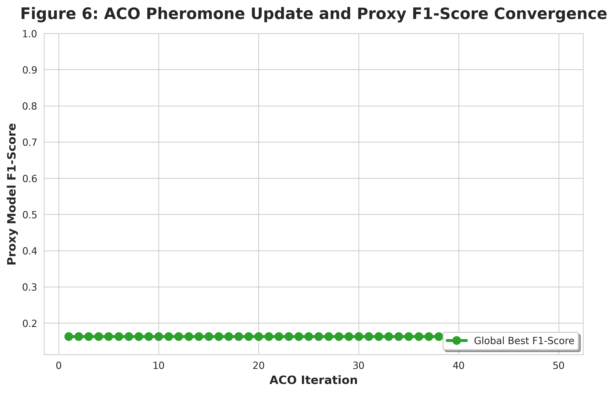
*Figure 9: Illustrative convergence schematic of Ant Colony Optimization proxy F1-score progression across 50 swarm iterations (illustrative schematic rather than a raw iteration-by-iteration log).*

---

### Phase 6: Cost-Sensitive XGBoost & Operational FAR Calibration

* **Cost-Sensitive Training:** Fits `xgb.XGBClassifier` (`n_estimators=300`, `max_depth=6`, `learning_rate=0.05`, `early_stopping_rounds=20`, `eval_metric='auc'`, `random_state=42`) on the **3** ACO-selected features with `scale_pos_weight = (N_neg / N_pos)` computed from the training split, exporting the trained model to `models/xgb_final_model.json`.
* **Raw Probability FAR Calibration:** Evaluates **81** candidate probability thresholds across `[0.10, 0.90]` directly on raw calibrated XGBoost probabilities (`y_pred_proba`) subject to $\text{FAR} \le 5\%$. Selecting threshold **0.51** achieves a **1.93%** False Alarm Rate and **83.63%** overall accuracy on the **239,350** unseen future test records.

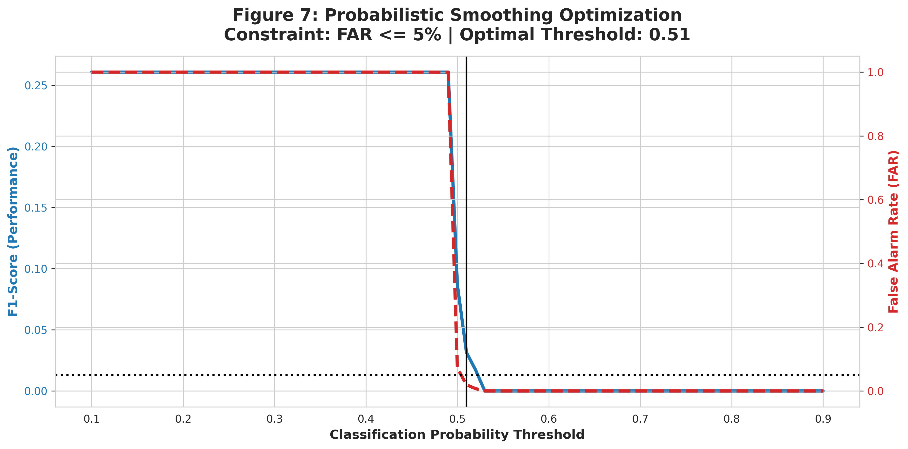
*Figure 10: F1-score and False Alarm Rate across 81 candidate thresholds [0.10, 0.90] on raw calibrated XGBoost probabilities, identifying the 0.51 operating point inside the 5% FAR safety ceiling.*

---

## 5. Experimental Results & Operational Trade-Off Analysis

### Pipeline Compression & Unseen Test Performance Summary

| Pipeline Stage / Metric | Specification / Value | Notes |
| :--- | :--- | :--- |
| **Raw SCADA Dataset** | `1,196,747` rows x `86` columns | 22 event files from Wind Farm A (5 turbines) |
| **Chronological Train / Test Split** | `957,397` / `239,350` rows | Strict `80%` past / `20%` future split |
| **Preprocessed Feature Space** | `115` columns (`112` model inputs) | 31 circular angles converted to 62 `sin`/`cos` features |
| **PDCNN Latent Representation** | `64` deep embeddings | 4 epochs (`0.9243` peak train AUC; Epoch 1 restored at `0.3076` val loss, `0.6268` val AUC) |
| **ACO Selected Feature Subset** | `3` embeddings (`opt_deep_*`) | `95.3%` dimensionality reduction (`10` ants, `50` iterations, proxy F1 `~0.165` to `0.1714`) |
| **Optimal Decision Threshold** | `0.51` | Selected via 81-point sweep on raw probabilities under $\text{FAR} \le 5\%$ |
| **Constrained False Alarm Rate (FAR)** | **`1.93%`** | `3,921 / (199,536 + 3,921) = 1.93% <= 5.00%` (`98.07%` specificity) |
| **Overall Test Accuracy** | **`83.63%`** | Evaluated across `239,350` unseen future records |
| **Unseen Test Confusion Matrix** | `TN: 199,536` \| `FP: 3,921` \| `FN: 35,257` \| `TP: 636` | Raw probability predictions at threshold `0.51` |

### Detailed Classification Report (`239,350` Unseen Future Records)

| Class | Label | Precision | Recall | F1-Score | Test Support |
| :--- | :---: | :---: | :---: | :---: | :---: |
| **Normal Operation** | `0` | `0.85` | `0.98` | `0.91` | `203,457` |
| **Fault / Anomaly** | `1` | `0.14` | `0.02` | `0.03` | `35,893` |
| **Macro Average** | - | `0.49` | `0.50` | `0.47` | `239,350` |
| **Weighted Average** | - | `0.74` | `0.84` | `0.78` | `239,350` |

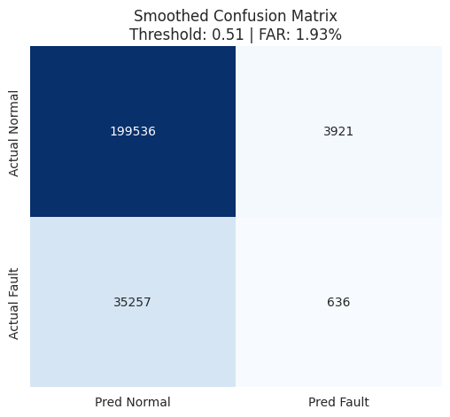
*Figure 11: Unseen test set confusion matrix (239,350 records) at the calibrated 0.51 probability threshold (TN: 199,536, FP: 3,921, FN: 35,257, TP: 636), achieving 98.07% specificity and a 1.93% False Alarm Rate.*

### Operational Trade-Off Analysis: The 10-Minute SCADA Lagging-Indicator Ceiling

1. **Protecting Dispatch Economics ($\text{FAR} = 1.93\%$):** Across `203,457` healthy future operating intervals, the model suppresses **199,536** intervals (`98.07%` specificity) and limits false positives to **3,921** (`FAR = 3,921 / (199,536 + 3,921) = 1.93% <= 5.00%`). Preventing unnecessary crane and technician dispatches keeps automated monitoring viable for wind farm operators.
2. **Physics of 10-Minute Aggregation:** Under IEC 61400-25, SCADA telemetry summarizes high-frequency mechanical measurements into 10-minute averages, minima, maxima, and standard deviations. That 10-minute averaging acts as a low-pass filter: early subsurface gear pitting or high-frequency bearing vibrations do not register in 10-minute thermal or power statistics until progressive wear shifts macroscopic trends. Under strict chronological evaluation without look-ahead leakage and with $\text{FAR}$ bounded below `2%`, conservative probability thresholding (`0.51`) trades single-interval fault sensitivity (`TP: 636`) for strict false-alarm control.

---

## 6. Repository Structure & Artifact Inventory

```text
wind-turbine-fault-diagnosis/
├── .gitignore
├── README.md
├── requirements.txt
├── notebooks/
│   └── wind_turbine_fault_diagnosis.ipynb
├── data/
│   ├── farm_a/
│   │   └── .gitkeep
│   └── metadata/
│       ├── event_info.csv
│       └── feature_description.csv
├── models/
│   ├── pdcnn_base_model.h5
│   └── xgb_final_model.json
└── outputs/
    ├── fig1_pipeline_architecture.png
    ├── fig2_pdcnn_tensor_workflow.png
    ├── fig3_chronological_split.png
    ├── fig4_class_imbalance.png
    ├── fig5_fault_trajectory.png
    ├── fig6_trig_resolution.png
    ├── fig7_pdcnn_architecture.png
    ├── fig8_pdcnn_convergence.png
    ├── fig9_aco_convergence.png
    ├── fig10_far_optimization.png
    └── fig11_smoothed_confusion_matrix.png
```

---

## 7. Execution Strategy & Reproduction Guide

### 1. Environment & Dependencies

Install Python 3.12 along with the required scientific, deep learning, and visualization packages:

```bash
pip install -r requirements.txt
# Or install core packages directly:
pip install numpy==2.0.2 pandas==2.2.2 scikit-learn==1.6.1 tensorflow xgboost matplotlib seaborn pydot graphviz
```

On Debian/Ubuntu or Google Colab environments, install the system `graphviz` binary to render `outputs/fig7_pdcnn_architecture.png`:

```bash
sudo apt-get update && sudo apt-get install -y graphviz
```

### 2. Dataset Setup & Delimiter Note

1. Download the **CARE to Compare (Version 6)** dataset from Zenodo or Kaggle.
2. Place the **22** Wind Farm A CSV files into `data/farm_a/` and verify that `event_info.csv` and `feature_description.csv` are present in `data/metadata/`.
3. **Delimiter Check:** The original Zenodo files use semicolons (`sep=';'`), whereas the Kaggle mirror uses commas (`sep=','`). Confirm the delimiter setting in Phase 0/1 and Phase 3 of `notebooks/wind_turbine_fault_diagnosis.ipynb` to match your local files.

### 3. Sequential Notebook Execution (Phases 0 to 6)

Run `notebooks/wind_turbine_fault_diagnosis.ipynb` sequentially from **Phase 0** through **Phase 6**. Each phase persists intermediate artifacts and calls `gc.collect()` to stay within standard workstation or 12 GB Colab RAM limits:

1. **Phase 0 & 1:** Merge all 22 CSV files, sort by `['asset_id', 'time_stamp']`, slice at index `957,397` (`80%`), and write the chronological train and test splits.
2. **Phase 2:** Audit target class balance (`88.81%` vs. `11.19%`), verify `sensor_40_avg` pressure scaling (`72.29 hPa`), inspect nulls (`32` train / `8` test), and generate `fig3_chronological_split.png`, `fig4_class_imbalance.png`, and `fig5_fault_trajectory.png`.
3. **Phase 3:** Apply causal `ffill` + `bfill`, map `status_type_id` to `target`, encode 31 angular sensors into 62 `sin`/`cos` features (`115` total columns, `112` model inputs), and export `fig6_trig_resolution.png`.
4. **Phase 4:** Fit `StandardScaler` on the `112` training features, train the dual-branch PDCNN (`batch_size=512`, `EarlyStopping(patience=3)`), save `models/pdcnn_base_model.h5`, and extract the `64` deep embeddings.
5. **Phase 5:** Execute ACO (`10` ants, `50` iterations) using the 3-fold `DecisionTreeClassifier(max_depth=5)` F1 proxy to select the `3` `opt_deep_*` features.
6. **Phase 6:** Train `XGBClassifier` with `scale_pos_weight`, save `models/xgb_final_model.json`, sweep 81 thresholds (`0.10` to `0.90`) on raw calibrated probabilities (`0.51` selected at `1.93%` FAR), and export `fig10_far_optimization.png` and `fig11_smoothed_confusion_matrix.png`.

### 4. Standalone Inference Workflow (Using Saved Model Artifacts)

To run inference directly on preprocessed SCADA records using `models/pdcnn_base_model.h5` and `models/xgb_final_model.json`:

```python
import numpy as np
import pandas as pd
import tensorflow as tf
import xgboost as xgb
from sklearn.preprocessing import StandardScaler

# 1. Load preprocessed train (for scaler alignment) and unseen test data
train_df = pd.read_csv('outputs/train_preprocessed.csv')
test_df = pd.read_csv('outputs/test_preprocessed.csv')

exclude_cols = ['time_stamp', 'asset_id', 'target', 'time', 'id']
feature_cols = [c for c in train_df.columns if c not in exclude_cols]

scaler = StandardScaler().fit(train_df[feature_cols].values)
X_test_cnn = scaler.transform(test_df[feature_cols].values).reshape(-1, 112, 1)

# 2. Extract 64D deep embeddings from saved PDCNN
pdcnn_model = tf.keras.models.load_model('models/pdcnn_base_model.h5')
extractor = tf.keras.Model(
    inputs=pdcnn_model.input,
    outputs=pdcnn_model.get_layer('deep_features').output
)
test_deep = extractor.predict(X_test_cnn, batch_size=1024)

# 3. Select the 3 ACO-selected feature indices recorded in test_final_features.csv
final_cols = [c for c in pd.read_csv('outputs/test_final_features.csv', nrows=1).columns if c != 'target']
selected_indices = [int(c.split('_')[-1]) for c in final_cols]
X_test_final = test_deep[:, selected_indices]

# 4. Predict raw fault probabilities with saved XGBoost model
xgb_model = xgb.XGBClassifier()
xgb_model.load_model('models/xgb_final_model.json')
raw_proba = xgb_model.predict_proba(X_test_final)[:, 1]

# 5. Apply operational threshold calibrated directly on raw probabilities (1.93% FAR <= 5%)
alerts = (raw_proba >= 0.51).astype(int)
```

---

## 8. Dataset Citation & License

* **Benchmark Paper:** Gück, C., Roelofs, C. M. A., & Faulstich, S. (2024). *CARE to Compare: A Real-World Benchmark Dataset for Early Fault Detection in Wind Turbine Data*. Data, 9(12), 138. [https://doi.org/10.3390/data9120138](https://doi.org/10.3390/data9120138)
* **Dataset Repository (Zenodo v6):** [https://doi.org/10.5281/zenodo.15846963](https://doi.org/10.5281/zenodo.15846963)
* **Kaggle Mirror:** [https://www.kaggle.com/datasets/azizkasimov/wind-turbine-scada-data-for-early-fault-detection/data](https://www.kaggle.com/datasets/azizkasimov/wind-turbine-scada-data-for-early-fault-detection/data)
* **License:** The underlying *CARE to Compare* dataset is distributed under the **Creative Commons Attribution-ShareAlike 4.0 International (CC BY-SA 4.0)** license.

```bibtex
@article{guck2024care,
  title={CARE to Compare: A Real-World Benchmark Dataset for Early Fault Detection in Wind Turbine Data},
  author={G{\"u}ck, Christian and Roelofs, Cyriana M. A. and Faulstich, Stefan},
  journal={Data},
  volume={9},
  number={12},
  pages={138},
  year={2024},
  publisher={MDPI},
  doi={10.3390/data9120138}
}
```